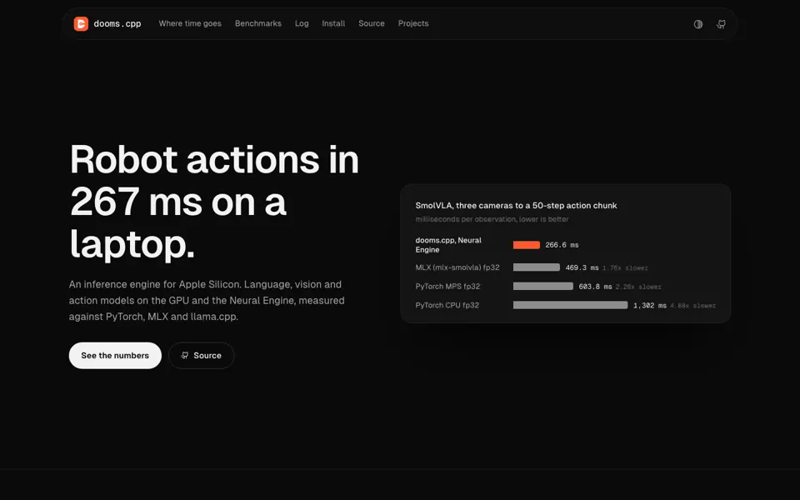
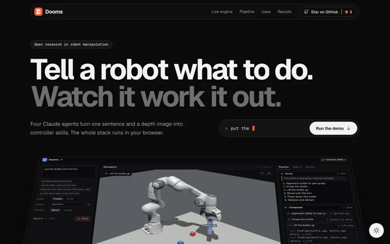
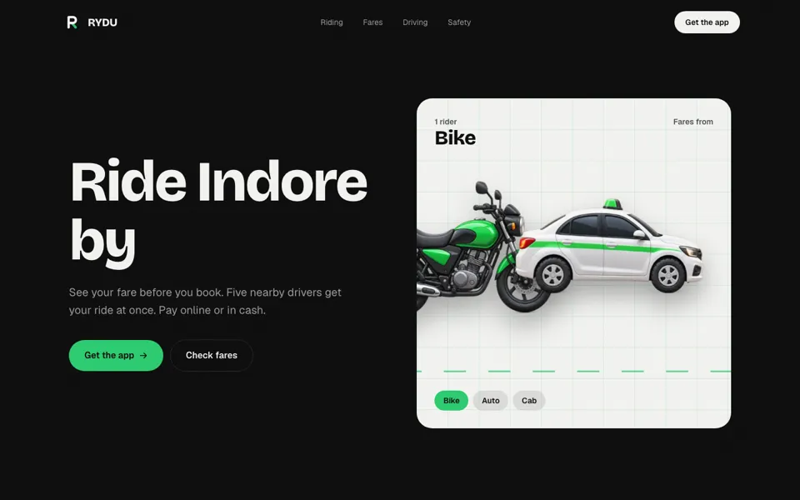
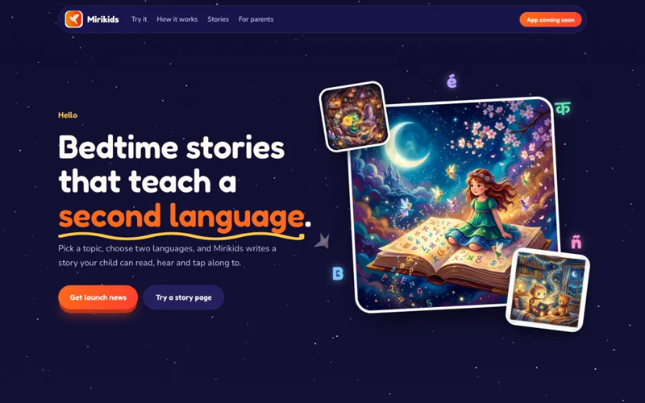

<picture>
  <source media="(prefers-color-scheme: dark)" srcset="assets/name-dark.svg">
  
</picture>

**Software engineer at HUB9. I build AI products, and the engines under them.**

Python, FastAPI, React and LLMs by day. On my own: an inference engine for Apple Silicon, a robot arm that plans from one sentence, a ride app for Indore and a language app for kids.

---

<table>
  <tr>
    <td width="50%" valign="top">
      
      <h3><a href="https://dooms-kappa.vercel.app">dooms.cpp</a></h3>
      An inference engine for Apple Silicon. Language, vision-language and robot-action models on the GPU (Metal) and the Neural Engine (Core ML), with C++, C and Python APIs.
        
      SmolVLA goes from three cameras to 50 robot actions in <b>267 ms</b>, 2.3x faster than PyTorch on the same Mac. LLM decoding is level with llama.cpp itself.
        
      <code>C++</code> <code>Metal</code> <code>Core ML</code> <code>llama.cpp</code> <code>Python</code>
        
      <a href="https://dooms-kappa.vercel.app">Website</a> · <a href="https://github.com/jay7828/dooms">Source (Apache-2.0)</a>
    </td>
    <td width="50%" valign="top">
      
      <h3><a href="https://dooms-inference.vercel.app">Dooms Inference</a></h3>
      Tell a robot what to do, watch it work it out. One sentence and one depth image become controller skills for a robot arm: four Claude agents plan, and a MuJoCo simulation runs it, all in the browser.
        
      <b>94.7%</b> accuracy over 150 trials with Claude.
        
      <code>TypeScript</code> <code>MuJoCo WASM</code> <code>Claude</code> <code>Three.js</code> <code>Python</code>
        
      <a href="https://dooms-inference.vercel.app">Try it in the browser</a> · <a href="https://github.com/jay7828/Dooms-inference">Source (Apache-2.0)</a>
    </td>
  </tr>
  <tr>
    <td width="50%" valign="top">
      
      <h3><a href="https://rydu-gray.vercel.app">RYDU</a></h3>
      Bike, auto and cab rides in Indore. Riders see the fare before they book, and five nearby drivers get the request at once.
        
      <code>FastAPI</code> <code>PostGIS</code> <code>Redis</code> <code>Flutter</code> <code>Next.js</code>
        
      <a href="https://rydu-gray.vercel.app">Website</a>
    </td>
    <td width="50%" valign="top">
      
      <h3><a href="https://www.mirikids.in">Mirikids</a></h3>
      Bedtime stories that teach a second language. Every story is written in two languages side by side, and children can read, hear and tap along to it. The app is coming soon.
        
      <code>Expo</code> <code>FastAPI</code> <code>LLMs</code> <code>Text to speech</code>
        
      <a href="https://www.mirikids.in">Website</a> · <a href="https://www.instagram.com/kids.miri/">Instagram</a>
    </td>
  </tr>
</table>

## At HUB9

Software Engineer since September 2024, remote for San Francisco, working across four products.

**[Motion Intelligence](https://www.motionintelligence.xyz)** · a platform for packaging, deploying and running custom video models
- Lead engineer on the Python CLI that packages models into Docker images
- Built the official Node.js and TypeScript SDK, cutting client integration effort by 40%
- Quantization and GPU tuning cut inference latency by 45%; designed a streaming 3D-reconstruction pipeline on S3

**[DBX Studio](https://www.dbxstudio.com)** · an AI SQL assistant
- Founding engineer: architected the platform from scratch
- FastAPI backend with LLM-powered query generation across PostgreSQL, MySQL and SQLite; 15+ active beta users

**[SumrLabs](https://sumrlabs.com)** · clinical summaries and medical-code ranking
- HIPAA-conscious FastAPI microservices; PostgreSQL schemas that cut data-retrieval time by 24%
- AWS Polly and Transcribe integration cut documentation time by 20%

**[June Kids](https://www.junekids.xyz)** · a storytelling app with personalised stories and voice narration
- Lead engineer on the React Native (Expo) app, with FastAPI services on AWS Lambda for story generation
- RevenueCat subscriptions with credit-based billing, Cognito and Google Sign-In

Before HUB9: Web Developer Intern at DevFolks, Indore (2023).

## What I work with

  

**AI:** LLMs, LangChain, LangGraph, RAG, agents, Claude on Bedrock

**Physical AI and robotics:** VLA models (SmolVLA), vision-language models, MuJoCo, NVIDIA Isaac Sim, robot-arm control from language and depth

**Inference engines:** dooms.cpp (my own), llama.cpp and GGUF, Metal, Core ML, model quantization

**Desktop:** Electron · **Also shipped with:** GPU optimization, video inference, 3D reconstruction, WebRTC, FHIR, RevenueCat

**Certified:** Oracle Cloud Infrastructure 2025: [Generative AI Professional](https://catalog-education.oracle.com/ords/certview/sharebadge?id=6B209283041FDD54CAC69FC9CD877377610C70FD8AE1DEE4D00A47E2736E34B7) · [Developer Professional](https://catalog-education.oracle.com/ords/certview/sharebadge?id=E422CDB9F606C4130986FFB314E7044059435F6C52E78FE76CB22A373A1B03A5) · [Data Science Professional](https://catalog-education.oracle.com/ords/certview/sharebadge?id=80091506A0D4B471FDF7319DB4AF6334DCCA72BB929EE37317E61E23A7C25422) · [DevOps Professional](https://catalog-education.oracle.com/ords/certview/sharebadge?id=80091506A0D4B471FDF7319DB4AF6334F80319E846CF73511F04FCB5D1626FD8)

**Education:** B.Tech in Information Technology, IIST Indore (CGPA 8.55)

## GitHub activity

<picture>
  <source media="(prefers-color-scheme: dark)" srcset="https://raw.githubusercontent.com/jay7828/jay7828/output/stats-dark.svg">
  
</picture>

<picture>
  <source media="(prefers-color-scheme: dark)" srcset="https://raw.githubusercontent.com/jay7828/jay7828/output/snake-dark.svg">
  
</picture>

## Contact

The fastest way to reach me is email: **[jayesh.work011@gmail.com](mailto:jayesh.work011@gmail.com)**. Based in Indore, India, and open to new roles and collaborations.

[Portfolio](https://www.jayeshsharma.me) · [LinkedIn](https://www.linkedin.com/in/jayesh-sharma-704283251/) · Phone +91 7828123916
